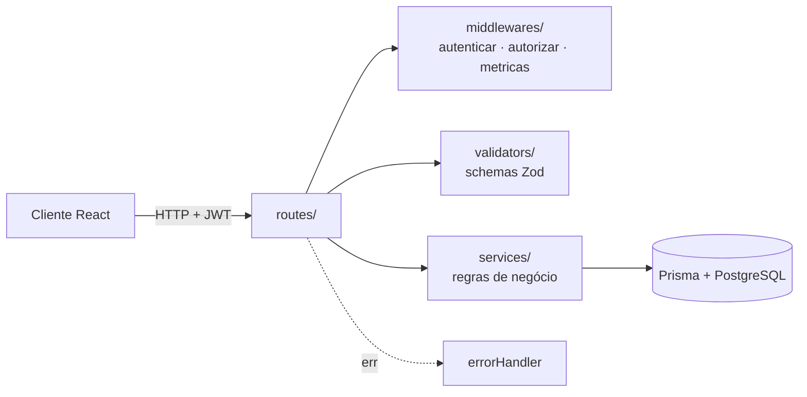
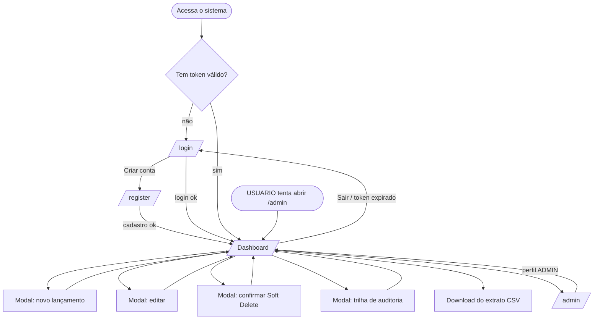

# Arquitetura, Segurança e Desempenho

## 1. Camadas do backend (Etapa 2)



| Camada | Responsabilidade |
| :-- | :-- |
| `routes/` | Recebe a requisição, valida com o schema e chama o serviço. Não tem regra de negócio. |
| `validators/` | Schemas Zod: formato, tipos e limites de cada entrada. |
| `services/` | Regras de negócio (idempotência, soft delete, auditoria, saldo, relatórios). |
| `middlewares/` | Autenticação JWT, autorização por perfil (RBAC), métricas e tratamento central de erros. |
| `errors/` | `AppError`: erro de negócio com status HTTP. |

## 2. Fluxo de dados de uma criação (Etapa 4 · validação do fluxo)

```mermaid
sequenceDiagram
    participant F as Frontend
    participant A as API (Express)
    participant Z as Zod
    participant DB as PostgreSQL
    F->>A: POST /api/transacoes (JWT, valorCentavos=200000)
    A->>A: autenticar (verifica JWT e busca usuário)
    A->>Z: criarTransacaoSchema.parse(body)
    Z-->>A: dados válidos (ou 400)
    A->>DB: existe chaveUnica para este usuário?
    DB-->>A: não (se sim: 409)
    A->>DB: BEGIN; INSERT Transacao; INSERT Auditoria(CRIACAO); COMMIT
    A-->>F: 201 + transação
    F->>A: GET /api/dashboard + /api/relatorios/mensal
    A-->>F: saldo recalculado no banco
```

## 3. Critérios de segurança e RBAC (Etapa 5)

| Critério | Implementação |
| :-- | :-- |
| Autenticação | JWT assinado com `JWT_SECRET`, expiração configurável (`JWT_EXPIRES_IN`). |
| Senhas | `bcrypt` (10 rounds). Mínimo de 6 caracteres. |
| Autorização por recurso | Todo acesso a transações filtra por `usuarioId` do token. Acessar a transação de outro usuário retorna 404 (não revela que ela existe). |
| **RBAC** | Perfis `ADMIN` e `USUARIO`. O primeiro usuário cadastrado vira `ADMIN`; os demais entram como `USUARIO`. |
| Perfil sempre atualizado | O perfil é lido do banco a cada requisição: promover ou rebaixar vale na hora, sem esperar o token expirar. |
| Sem ficar sem admin | Um admin não pode remover o próprio perfil ADMIN. |
| Validação | Zod em todo body e query string; campos extras são recusados (impede, por exemplo, enviar `usuarioId` ou `deletadoEm`). |
| CORS | Restrito à origem do frontend (`CORS_ORIGIN`). |
| Vazamento de erros | 500 responde só "Erro interno do servidor"; o detalhe fica no log. |
| Defesa em profundidade | Triggers no banco garantem a Regra de Ouro mesmo se a API for contornada. |

### Matriz de permissões

| Recurso | USUARIO | ADMIN |
| :-- | :-: | :-: |
| CRUD das **próprias** transações, dashboard, relatórios, extrato | ✅ | ✅ |
| Totais de toda a empresa (`/api/admin/dashboard`) | ❌ 403 | ✅ |
| Listar usuários e alterar perfis | ❌ 403 | ✅ |
| Auditoria global | ❌ 403 | ✅ |
| Métricas de desempenho | ❌ 403 | ✅ |
| Apagar fisicamente qualquer registro | ❌ | ❌ (bloqueado pelo banco) |

## 4. Fluxos de navegação (Etapa 6)



| Rota | Quem acessa | Se não puder |
| :-- | :-- | :-- |
| `/login`, `/register` | Quem **não** está logado | Redireciona para `/` |
| `/` | Qualquer usuário logado | Redireciona para `/login` |
| `/admin` | Somente `ADMIN` | Redireciona para `/` (e a API responde 403) |
| Qualquer outra | — | Redireciona para `/` |

## 5. Modelagem de desempenho das consultas e métricas (Etapas 7 e 9)

### Índices

| Índice | Consultas atendidas |
| :-- | :-- |
| `Transacao(usuarioId, deletadoEm, dataTransacao DESC)` | Listagem paginada, filtros por período, dashboard, relatório mensal, extrato |
| `Transacao(usuarioId, chaveUnica)` **único** | Verificação de duplicidade (idempotência) |
| `Auditoria(transacaoId, dataAcao DESC)` | Trilha de uma transação |
| `Auditoria(dataAcao DESC)` | Auditoria global paginada (admin) |
| `Auditoria(usuarioId)` | Filtro da auditoria global por usuário |

Verificação com `EXPLAIN` (PostgreSQL 16; com poucos registros o planejador prefere varredura sequencial, então o teste foi feito com `SET enable_seqscan = off`):

```
Limit
  -> Bitmap Heap Scan on "Transacao"
       -> Bitmap Index Scan on "Transacao_usuarioId_deletadoEm_dataTransacao_idx"
            Index Cond: (("usuarioId" = 2) AND ("deletadoEm" IS NULL) AND ("dataTransacao" >= '2026-11-01'))

Index Scan using "Auditoria_transacaoId_dataAcao_idx" on "Auditoria"
  Index Cond: ("transacaoId" = 5)
```

### Decisões de desempenho

- **Paginação obrigatória** (padrão 10, máximo 100): o custo de uma página não cresce com o total de registros.
- **Agregações no banco**: saldo (`aggregate`) e relatório mensal (`GROUP BY date_trunc('month', ...)`) são calculados no PostgreSQL, sem trazer todas as linhas para o Node.
- **Consultas em paralelo**: página + contagem total, entradas + saídas, executadas com `Promise.all`.
- **Busca textual**: `ILIKE` (`contains`, sem diferenciar maiúsculas) já restrito pelo índice de usuário. Se o volume crescer muito, o próximo passo é um índice `pg_trgm` em `descricao`.
- **Frontend**: busca com *debounce* (400 ms) para não disparar uma requisição por tecla; `memo`/`useMemo`/`useCallback` nos componentes da listagem e do gráfico.

### Métricas

- Todo response traz o header `X-Response-Time`.
- `GET /api/admin/metricas` (e a tela `/admin`) mostram, por rota: quantidade de chamadas, tempo médio, tempo máximo e erros 5xx desde a última inicialização.
